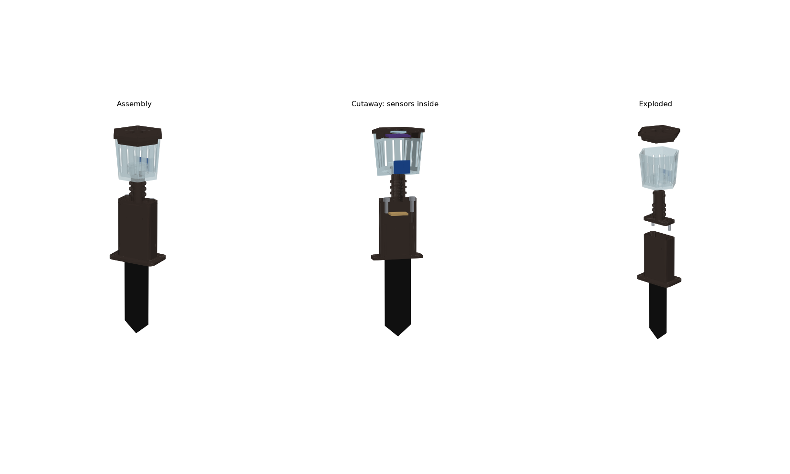

# Nabta sensor stake: CAD and printing

> **New:** the v2 cap, housing and lantern (larger hexagon) are in [`v2/`](v2/). Everything else on this page is the v1 design.

## Files

| File | What it is |
|---|---|
| `nabta_sensor_stake_assembly.step` | Full assembly with the sensors in place. Open it in FreeCAD with **File → Open** |
| `nabta_sensor_stake_exploded.step` | Same assembly, pulled apart |
| `parts/*.step` | Each printed part alone, for editing |
| `print_stl/*.stl` | Ready to slice, already turned the right way for printing |
| `build_stake.py` | The parametric source. Change a size at the top and run it again |

Height: 112 mm above the soil, plus the 72 mm sensor blade in the soil. Widest part: 46 mm (cap).

## Before you print: measure your boards

Cheap modules vary. Check these with a caliper. If one is different, change it at the top of `build_stake.py` and run `python build_stake.py` (needs `pip install cadquery`).

| Board | Size in the model |
|---|---|
| Capacitive soil sensor v1.2 | 23.0 × 98 × 1.6 mm, electronics in the top 26 mm |
| SHT31 breakout | 14.0 × 11.0 mm |
| GY-302 BH1750 | 18.5 × 13.9 mm, light chip in the centre |

## Print settings

No part needs supports.

| Part | Material | Orientation (already set in the STL) | Settings |
|---|---|---|---|
| housing | PETG or ASA, dark | Collar flat on the bed | 0.2 mm layers, 4 walls, 30 % infill |
| stem | PETG or ASA, dark | Flange flat on the bed | 0.2 mm, 4 walls, 40 % infill |
| lantern | **Clear PETG** | Bottom plate on the bed | 0.2 mm, 2 walls, 15 % infill |
| cap | PETG or ASA, dark | Upside down (top on the bed) | 0.2 mm, 3 walls, 20 % infill |
| window_disc | **Clear PETG** | Flat | 0.1–0.15 mm layers, 100 % infill |

## Hardware

- 2 × M3 × 10 mm screws (they cut their own thread in the 2.5 mm holes)
- 5-core cable, Ø ≤ 6 mm; a small perfboard (15 × 10 mm) for the splice
- Silicone sealant or hot glue, heat-shrink tubing
- Clear nail polish or conformal coating for the soil sensor

## Assembly

1. **Protect the soil sensor.** Paint the cut edges of the blade and the electronics with nail polish or conformal coating. Bare edges soak up water and the reading drifts within weeks.
2. Solder the 3 soil-sensor wires and 8 wires for the SHT31 and BH1750 (4 each: 3.3 V, GND, SDA, SCL) to the splice board. Push the 5-core cable through the front hole of the housing and solder it to the same board.
3. Slide the soil sensor in from the top of the housing. The blade goes through the slot in the floor, and the board edges ride in the two side grooves.
4. Lay the splice board on the two ledges. Seal the floor slot and the cable hole with silicone from the inside.
5. Thread the 8 sensor wires up through the stem. Screw the stem onto the housing with the 2 M3 screws.
6. Solder the SHT31 and slide it into the two grooved posts inside the lantern, sensor chip facing the vents.
7. **Twist-lock:** line up the lantern's slots with the 2 lugs on top of the stem, push down, then twist about 40° anticlockwise (seen from above) until it stops.
8. Press the window disc into the cap's recess (a drop of glue holds it). Slide the BH1750 into the rails under the cap, sensor facing up, until it hits the end stop. The chip then sits under the window.
9. Push the cap into the top of the lantern. Its skirt is a friction fit.
10. Push the stake into the soil until the collar sits on the soil surface.

## Design notes

- Only the blade is in the soil. The sensor electronics stay above the soil line, inside the housing.
- The SHT31 sits in the vented lantern, far from the Pi's heat and out of direct water, so it reads the air around the plant.
- The light sensor looks up through the cap window, so leaves and the lantern walls don't shade it.
- All fits use 0.2 mm clearance per side. If your printer prints tight, raise `CL` in `build_stake.py`.
- I²C addresses: SHT31 0x44, BH1750 0x23 (ADDR left open).
