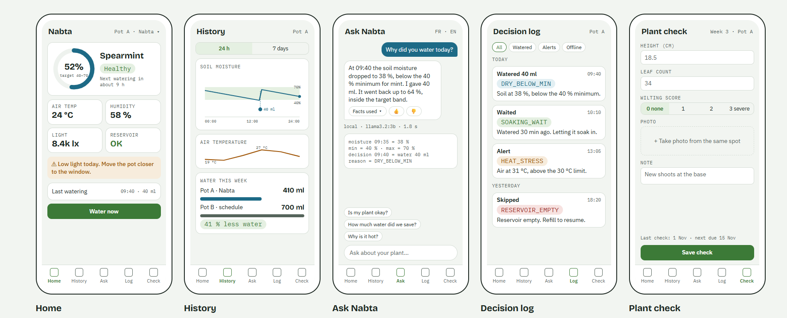

# Dashboard

**Owner:** Ahmed Ridha Melayah

What the user sees: the plant's condition, history, watering decisions, a chat with the assistant, and a weekly plant check.

## Folders and files

| Item | Content |
|---|---|
| [`features.pdf`](features.pdf) | App features: must-have vs. nice-to-have |
| [`sketches/`](sketches/) | Screen sketches and mockups |
| [`src/`](src/) | Dashboard source code |

---

## Screens

| Screen | What it shows |
|---|---|
| **Home** | Soil moisture vs. target range, plant health, air temperature, humidity, light, reservoir, alerts, last watering, "Water now" button |
| **History** | Soil moisture and air temperature charts (24 h / 7 days), water used this week vs. a pot on a fixed schedule |
| **Ask Nabta** | Chat with the assistant, with the facts it used for each answer, suggested questions and FR/EN switch |
| **Decision log** | Every watering, wait, skip and alert with its reason, filterable |
| **Plant check** | Weekly form: height, leaf count, wilting score, photo from the same spot, note |

---

## Features

**How we chose:** a feature is a must-have if the final demo or the plant study can't work without it. Everything else waits until the must-haves work.

### Must-have (build first)

| Feature | Description |
|---|---|
| Plant status | See soil moisture, temperature, humidity, light and the water tank level |
| Automatic watering | The pot waters itself when the soil is too dry |
| Alerts | Warns when the tank is empty, a sensor fails, or the plant is too hot or too dark |
| History | Charts of the last 24 hours and the last 7 days |
| Water saved | Compares the Nabta pot with a pot watered on a fixed schedule |
| Ask Nabta | A chat that answers questions about the plant in plain language |
| Decision log | A list of every watering, with the reason for it |
| Water now | A button to water by hand, still within the safety limits |
| Plant check | A weekly form for height, leaf count, wilting and a photo |

### Nice-to-have (only if there's time)

| Feature | Description |
|---|---|
| Notifications | Alerts on the phone even when the app is closed |
| Next watering time | Predicts when the plant will need water next |
| Photo timeline | The weekly photos side by side to see the plant grow |
| More languages | French / English switch, then answers in Darija |
| Second plant | Support for basil as well as mint |
| Remote access | Use the app away from home Wi-Fi |
