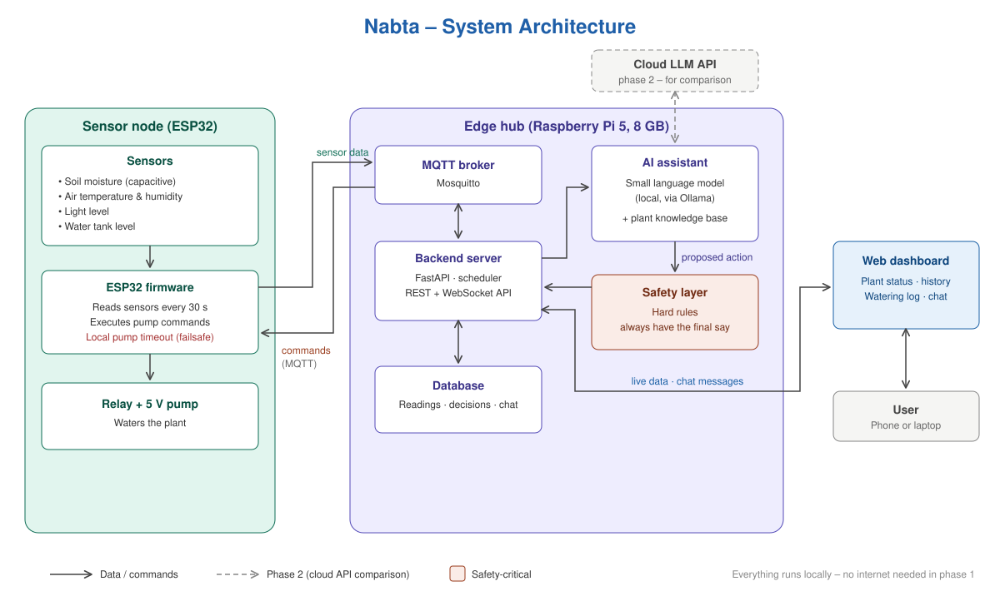
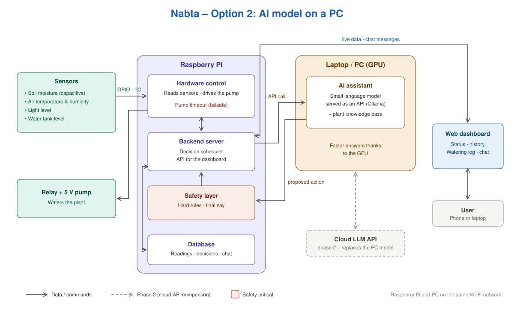

# System architecture

**Owner:** Ahmed Hamouda

Two architectures are possible. They are identical except for **where the AI model runs**. The rest of this page describes Architecture A; [Architecture B](#architecture-b-ai-model-on-a-pc) is at the end.

## Architecture A: everything on the Raspberry Pi

Nabta runs on a **single Raspberry Pi** placed next to the plant. The sensors and the pump connect directly to it, and the same board stores the data, runs the AI assistant and serves the dashboard.

In phase 1 everything runs locally: **no internet connection is needed**.

---

## Components

| Component | Runs on | Role |
|---|---|---|
| Sensors | Connected to the Pi | Soil moisture, air temperature and humidity, light, water tank level |
| Relay + pump | Connected to the Pi | Waters the plant |
| Hardware control | Raspberry Pi | Reads the sensors every 30 s, drives the pump, enforces a pump timeout |
| Backend server | Raspberry Pi | Stores readings, runs the decision cycle, serves the dashboard |
| Database | Raspberry Pi | Sensor readings, AI decisions with their explanations, chat history |
| AI assistant | Raspberry Pi | Small language model (local) + plant knowledge base: decides, explains, answers questions |
| Safety layer | Raspberry Pi | Hard rules that check every action before it reaches the pump |
| Web dashboard | User's browser | Plant status, history charts, watering log, chat with the assistant |
| Cloud LLM API | Internet (phase 2) | Same assistant on a cloud model, for the local vs. cloud comparison |

---

## Main flows

### 1. Monitoring
`Sensors → Hardware control → Backend → Database → Dashboard (live)`

### 2. Watering decision
1. The backend's scheduler wakes up periodically (and when moisture drops sharply).
2. It sends the AI the **context**: latest readings, recent history, last watering, plant profile.
3. The AI answers with a **proposed action** (water X seconds / don't water) and a short explanation.
4. The **safety layer** checks it against the hard rules and approves, shortens or rejects it.
5. An approved command goes to the hardware control, which runs the pump.
6. The decision and its explanation are stored and shown in the watering log.

### 3. User chat
`User → Dashboard → Backend → AI (with plant data + knowledge base) → answer → Dashboard`

---

## Key design decisions

- **One board for everything.** Fewer parts, simpler wiring and no device-to-device communication to debug.
- **The AI proposes, the rules decide.** The language model never controls the pump directly; every action passes the safety layer.
- **Two levels of failsafe.** The safety layer filters every decision, and the hardware control stops the pump after a maximum run time no matter what.
- **Local first.** The assistant runs on a small local model so Nabta works without internet; the cloud API is added in phase 2 only for comparison.
- **Same interface for local and cloud models.** The backend talks to the AI through one interface, so switching between the local model and the cloud API is a configuration change.

---

## Architecture B: AI model on a PC

Same system, but the **language model runs on a laptop/PC with a GPU** instead of on the Raspberry Pi. The Pi still reads the sensors, drives the pump, applies the safety rules, stores the data and serves the dashboard. When it needs the AI, the backend sends an **API request over Wi-Fi** to the model served on the PC (Ollama), and gets the proposed action back.

### Watering decision in B
1. The Pi's backend builds the context (readings, history, plant profile).
2. It sends it as an API request to the model on the PC.
3. The PC answers with a proposed action and an explanation.
4. The safety layer on the Pi checks it; approved commands go to the pump.

### What stays safe
- If the PC is off or unreachable, the Pi **does not water blindly**: it falls back to a simple rule (e.g. water only below a moisture threshold) and logs that the AI was unavailable.
- The safety layer and the pump timeout stay on the Pi, so the PC can never run the pump directly.

### Phase 2
The cloud LLM API replaces the PC model, exactly like in Architecture A.

---

## A vs. B

| | A – model on the Pi | B – model on a PC |
|---|---|---|
| AI response time | Slower (CPU only) | Faster (GPU) |
| Model size possible | Very small models only | Larger, smarter models |
| Works on its own | Yes, one device | Needs the PC on and on the same Wi-Fi |
| Hardware cost | Needs a more powerful Pi | A smaller Pi is enough |
| Closest to a real product | Yes | Good for development and demos |

The backend talks to the model through the same API in both cases, so switching between A and B (or to the cloud API) is a configuration change, not a redesign.
