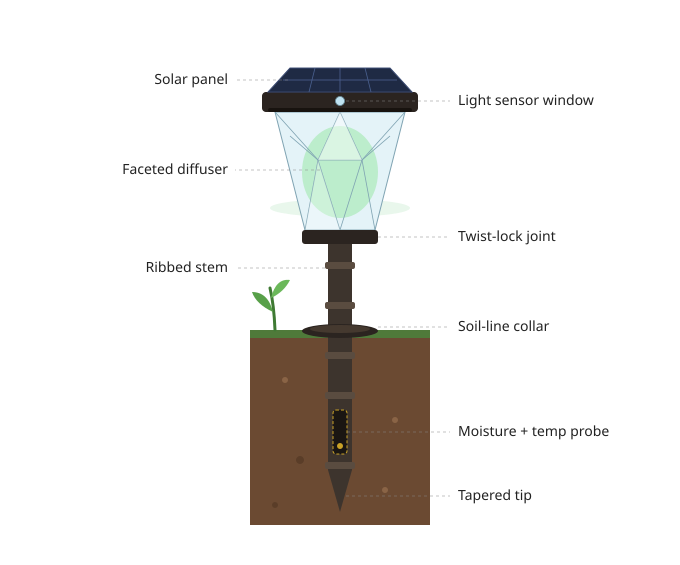
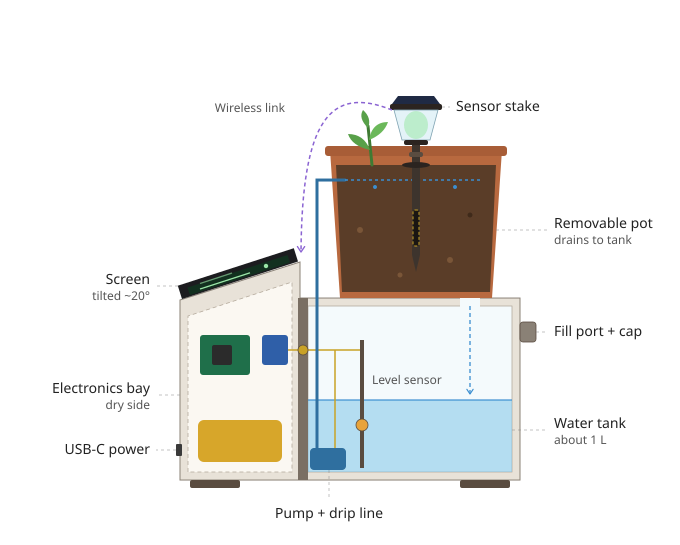

# Enclosure and 3D design

**Owner:** Youssef Ben Moussa

The physical housing of Nabta: a decorative sensor stake that stands in the pot, and a planter base that holds the electronics, the water tank and the pump.

## Folders

| Folder | Content |
|---|---|
| [`sketches/`](sketches/) | Concept drawings |
| [`cad/`](cad/) | 3D model source files and printable `.stl` files |
| [`renders/`](renders/) | Images of the final design |

---

## Concept 1: lantern sensor stake

Exterior view of the modular lantern stake, styled like a solar garden light. Three printable parts:

- **Cap:** solar panel, light sensor window, antenna space.
- **Lantern body:** faceted translucent diffuser around the MCU, battery and status LED (colour shows moisture state), joined to the stem by a twist-lock ring.
- **Stem:** ribbed bamboo-style tube with a collar at soil level, a capacitive moisture sensor and a temperature probe at root depth, and a tapered tip.

Suggested materials: ASA or PETG for the shell, clear PETG or resin for the diffuser.

---

## Concept 2: planter base layout

Side cutaway of the planter base (front on the left):

- **Front:** dry electronics bay (MCU, charge board, battery, USB-C) under an angled screen.
- **Rear:** water tank with fill port, level sensor and pump, under a removable pot that drains back into the tank.
- **Separation:** a sealed wall between the dry and wet zones, with a single gasketed cable pass-through.
- **Stem link:** the sensor stake stands in the pot and reports to the electronics wirelessly.

---

## Assumptions

- Self-watering via a small pump and drip ring.
- Water tank of about 1 L.
- Wireless link between the stake and the base.
- Sizes are placeholders until the pot and parts are fixed.

## Design requirements

- Electronics kept separate from the water side
- Visible water tank and screen window
- Ventilation for the Raspberry Pi
- Printable in parts on a standard 3D printer
